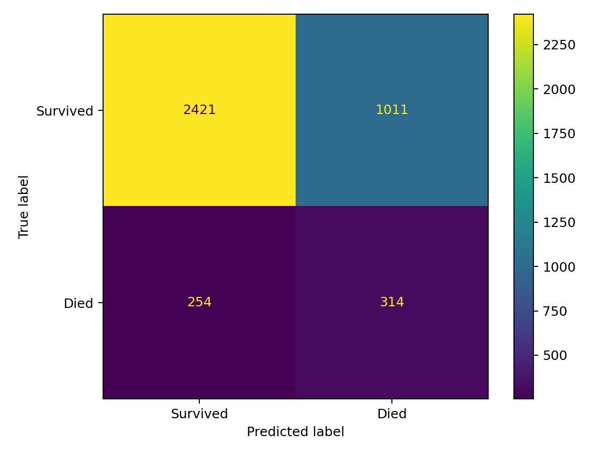
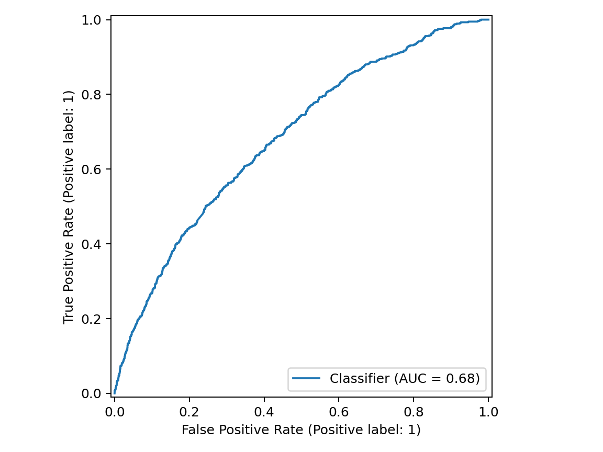
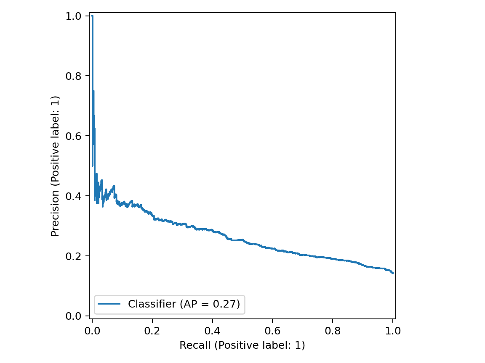
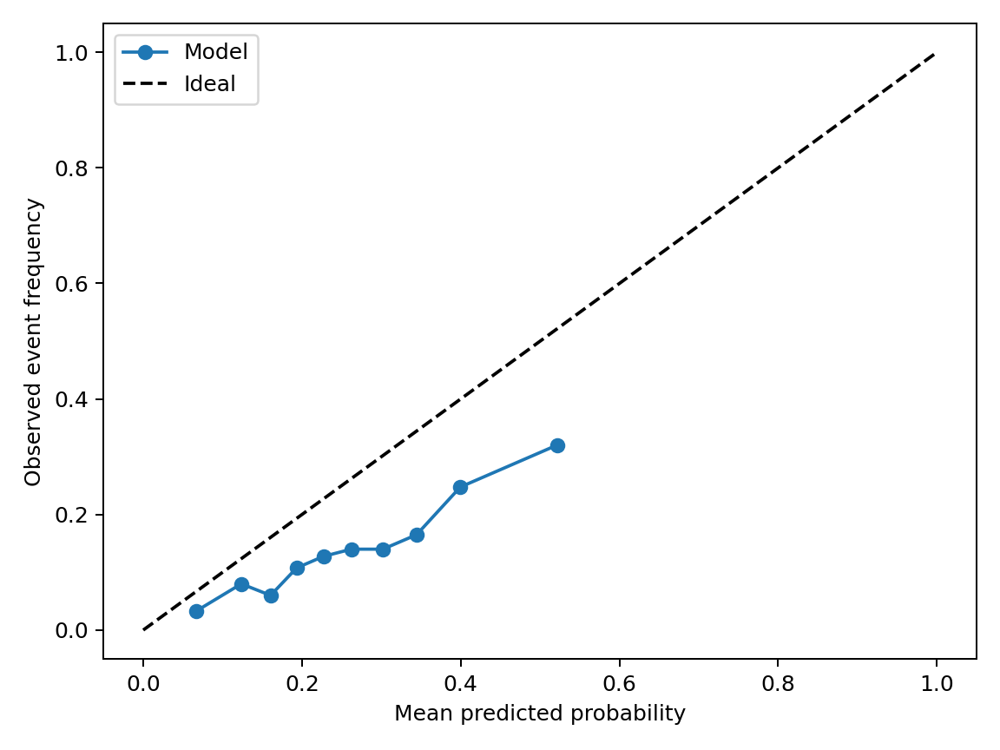
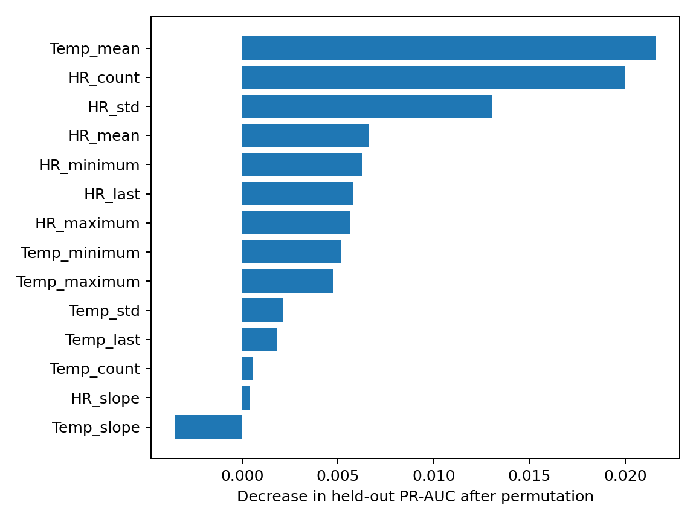

# PulseBridge research paper metrics pack

## Evidence boundary

The current research-paper draft describes a planned PhysioNet Challenge 2019 early-sepsis experiment using heart rate, oxygen saturation, temperature, and respiratory rate. That experiment has not produced the repository's verified metrics.

The completed and reproducible repository experiment instead uses the PhysioNet/Computing in Cardiology Challenge 2012 v1.0.0. It predicts eventual in-hospital death after observing the first 48 hours of an adult ICU stay, using heart rate and temperature summaries. The values below must therefore be presented as **ICU mortality classification results**, not as sepsis-prediction results and not as evidence of clinical performance in remote monitoring.

## Completed study design

| Item | Verified value |
|---|---|
| Dataset | PhysioNet/Computing in Cardiology Challenge 2012 v1.0.0 |
| Licence | Open Data Commons Attribution License 1.0 |
| Development partition | Official Set A: 4,000 ICU stays |
| Development deaths | 554 (13.85%) |
| Held-out partition | Official Set B: 4,000 ICU stays |
| Held-out deaths | 568 (14.20%) |
| Observation window | First 48 hours of the ICU stay |
| Target | Eventual in-hospital death versus survival |
| Input channels | Heart rate and temperature |
| Feature count | 14 |
| Development validation | Stratified five-fold cross-validation on Set A |
| Independent evaluation | One final evaluation on untouched Set B |
| Primary model-selection metric | PR-AUC |
| Selected model | Random forest |
| Decision threshold | 0.31, selected from Set A out-of-fold predictions |
| Random seed | 7077 |
| Model identifier | `physionet-2012-icu-mortality` |
| Model version | `icu-mortality-hr-temp-v1` |
| Artifact SHA-256 | `b8ac7bc41197a6516a4484064889ec3451ac753152f62d7a6f1bbd6fbee6b523` |

## Data availability and feature choice

Set A contained heart rate in 3,937 of 4,000 stays and temperature in 3,936 stays. Oxygen saturation appeared in 1,792 stays, respiratory rate in 1,101 stays, and only 171 stays contained all four signals. The completed study therefore used heart rate and temperature only rather than manufacturing missing channels or restricting the study to a very small four-vital complete-case cohort.

For each input channel, the extractor calculates minimum, maximum, mean, population standard deviation, last observed value, hourly linear slope, and observation count. The resulting features are:

1. HR minimum
2. HR maximum
3. HR mean
4. HR standard deviation
5. HR last value
6. HR hourly slope
7. HR observation count
8. Temperature minimum
9. Temperature maximum
10. Temperature mean
11. Temperature standard deviation
12. Temperature last value
13. Temperature hourly slope
14. Temperature observation count

Missing values remain missing until median imputation inside the fitted scikit-learn pipeline. Imputation and all other fitted transformations are learned only from training folds during cross-validation, preventing validation-fold leakage. Simulator measurements and rule-based classifications are excluded from model development and evaluation.

## Model comparison on development Set A

The following values are means across the executed five-fold cross-validation.

| Candidate | Balanced accuracy | Precision | Recall | F1 | ROC-AUC | PR-AUC | Brier score |
|---|---:|---:|---:|---:|---:|---:|---:|
| Majority dummy | 0.5000 | 0.0000 | 0.0000 | 0.0000 | 0.5000 | 0.1385 | 0.1385 |
| Logistic regression | 0.5937 | 0.1957 | 0.5524 | 0.2889 | 0.6297 | 0.2295 | 0.2336 |
| **Random forest selected** | 0.5502 | 0.4065 | 0.1317 | 0.1973 | **0.6960** | **0.2782** | **0.1272** |
| Histogram gradient boosting | **0.6082** | 0.2889 | 0.3574 | **0.3190** | 0.6728 | 0.2694 | 0.1520 |

The random forest was selected because it achieved the highest cross-validated PR-AUC, the predefined primary metric for the imbalanced mortality target. The comparison also shows why a single metric is insufficient: histogram gradient boosting produced the highest balanced accuracy and F1, while the random forest produced the strongest discrimination and lowest Brier score in cross-validation.

## Final held-out Set B results

| Metric | Result | Bootstrap 95% confidence interval |
|---|---:|---:|
| Accuracy | 0.6838 | Not calculated |
| Balanced accuracy | 0.6291 | Not calculated |
| Precision / positive predictive value | 0.2370 | Not calculated |
| Recall / sensitivity | 0.5528 | 0.5094-0.5928 |
| F1-score | 0.3317 | Not calculated |
| ROC-AUC | 0.6836 | 0.6591-0.7071 |
| PR-AUC / average precision | 0.2663 | 0.2376-0.3031 |
| Brier score | 0.1314 | Not calculated |
| Specificity | 0.7054 | Derived from the confusion matrix |
| Negative predictive value | 0.9050 | Derived from the confusion matrix |
| False-positive rate | 0.2946 | Derived from the confusion matrix |
| False-negative rate | 0.4472 | Derived from the confusion matrix |
| Matthews correlation coefficient | 0.1915 | Derived from the confusion matrix |

Set B mortality prevalence was 14.20%. The model predicted the death class for 33.13% of stays at the selected threshold. The PR-AUC of 0.2663 is above the 0.142 prevalence baseline, indicating predictive signal, but the error rates remain too large for clinical use.

## Confusion matrix at threshold 0.31

Rows are actual outcomes and columns are predicted outcomes.

| Actual outcome | Predicted survival | Predicted in-hospital death | Row total |
|---|---:|---:|---:|
| Survival | 2,421 true negatives | 1,011 false positives | 3,432 |
| In-hospital death | 254 false negatives | 314 true positives | 568 |
| Column total | 2,675 | 1,325 | 4,000 |

The model detected 314 of 568 deaths and missed 254. Of 1,325 positive predictions, 314 were correct. This explains the moderate recall and low precision and must be discussed prominently rather than presenting the ROC-AUC alone.

## Global permutation importance

Permutation importance was calculated on held-out Set B using change in PR-AUC. It describes global model reliance, not causation and not an explanation for one patient.

| Rank | Feature | Importance |
|---:|---|---:|
| 1 | Temperature mean | 0.02158 |
| 2 | HR observation count | 0.01995 |
| 3 | HR standard deviation | 0.01306 |
| 4 | HR mean | 0.00663 |
| 5 | HR minimum | 0.00630 |
| 6 | HR last value | 0.00581 |
| 7 | HR maximum | 0.00561 |
| 8 | Temperature minimum | 0.00515 |
| 9 | Temperature maximum | 0.00474 |
| 10 | Temperature standard deviation | 0.00215 |
| 11 | Temperature last value | 0.00185 |
| 12 | Temperature observation count | 0.00057 |
| 13 | HR slope | 0.00040 |
| 14 | Temperature slope | -0.00351 |

HR observation count may reflect clinical workflow and monitoring intensity as well as physiology. Negative or near-zero values mean that permuting the feature did not reduce held-out PR-AUC in this evaluation; they do not prove that the feature is physiologically unimportant.

## Figures ready for the paper

1. **Confusion matrix.** `ml/reports/generated/confusion-matrix.png`  
   Caption: *Confusion matrix for the selected random-forest classifier on held-out PhysioNet Challenge 2012 Set B at the predefined 0.31 decision threshold. Rows represent actual outcomes and columns represent predicted outcomes.*

2. **ROC curve.** `ml/reports/generated/roc-curve.png`  
   Caption: *Receiver operating characteristic curve for ICU mortality classification on held-out Set B. ROC-AUC was 0.6836 (bootstrap 95% CI 0.6591-0.7071).*

3. **Precision-recall curve.** `ml/reports/generated/precision-recall-curve.png`  
   Caption: *Precision-recall curve for the imbalanced held-out mortality task. Average precision was 0.2663 (bootstrap 95% CI 0.2376-0.3031), compared with a 0.142 positive-class prevalence.*

4. **Calibration curve.** `ml/reports/generated/calibration.png`  
   Caption: *Calibration of random-forest mortality probabilities on held-out Set B. The Brier score was 0.1314; the probabilities are research outputs and must not be interpreted as individualized clinical prognosis.*

5. **Permutation importance.** `ml/reports/generated/permutation-importance.png`  
   Caption: *Global permutation importance on held-out Set B using PR-AUC. Temperature mean, heart-rate observation count, and heart-rate variability produced the largest positive decreases when permuted. Importance is associative and non-causal.*

## Replacement text for the abstract

PulseBridge is a software-based remote patient monitoring research prototype that generates synthetic heart rate, peripheral oxygen saturation, body temperature and respiratory rate measurements, validates and stores them in PostgreSQL, and presents trends and assessments through role-restricted dashboards. The implemented system uses FastAPI, React, token-based authentication, role-based access control, measurement-quality metadata, audit events and internal alerts. Separately, a reproducible machine-learning study used the PhysioNet/Computing in Cardiology Challenge 2012 dataset to classify eventual in-hospital death after the first 48 hours of adult ICU stays from heart-rate and temperature summaries. Official Set A (4,000 stays) was used for five-fold cross-validation and model selection, and official Set B (4,000 stays) was retained for one final evaluation. A random forest selected by cross-validated PR-AUC achieved ROC-AUC 0.6836, PR-AUC 0.2663, recall 0.5528, precision 0.2370 and F1 0.3317 on Set B at a threshold of 0.31. These modest results demonstrate a reproducible research integration but include 254 false negatives and 1,011 false positives. The model is not clinically validated, does not assess SpO2 or respiratory rate, and cannot establish performance for remote-monitoring populations. PulseBridge is not a medical device and is not intended for diagnosis or treatment.

## Replacement text for the results section

The executed study used official PhysioNet Challenge 2012 Set A for development and official Set B for held-out evaluation. Set A contained 4,000 ICU stays, including 554 deaths (13.85%), while Set B contained 4,000 stays, including 568 deaths (14.20%). Heart rate and temperature were selected because they were available in 3,937 and 3,936 Set A stays respectively; only 171 stays contained heart rate, temperature, oxygen saturation and respiratory rate together. Four candidate classifiers were compared through stratified five-fold cross-validation using 14 summary features from the first 48 hours. The random forest achieved the highest mean PR-AUC (0.2782), compared with 0.2694 for histogram gradient boosting, 0.2295 for logistic regression and 0.1385 for the majority baseline, and was therefore selected under the predefined criterion.

On untouched Set B, the selected random forest achieved ROC-AUC 0.6836 (95% CI 0.6591-0.7071), PR-AUC 0.2663 (95% CI 0.2376-0.3031), balanced accuracy 0.6291 and Brier score 0.1314. At the decision threshold of 0.31 selected from Set A out-of-fold predictions, recall was 0.5528 (95% CI 0.5094-0.5928), precision was 0.2370 and F1 was 0.3317. The confusion matrix contained 2,421 true negatives, 1,011 false positives, 254 false negatives and 314 true positives. Thus, the model learned signal above the 14.2% prevalence baseline, but its false-positive and false-negative counts prevent clinical interpretation.

## Replacement text for the discussion

The completed evaluation supports only a limited conclusion: first-48-hour heart-rate and temperature summaries contain some signal associated with eventual in-hospital mortality in the historical Challenge 2012 cohort. Held-out ROC-AUC and PR-AUC were 0.6836 and 0.2663, but precision was only 0.2370 and 254 of 568 deaths were missed. The selected threshold increased sensitivity compared with a default 0.5 cutoff at the cost of 1,011 false-positive classifications. The importance of heart-rate observation count also suggests that clinical measurement practice may contribute predictive information, so feature importance cannot be read as a physiological or causal explanation. The evaluation does not answer the draft paper's planned early-sepsis question, does not validate the model for home monitoring, and does not establish clinical utility.

## Replacement text for the conclusion

PulseBridge demonstrates a secure full-stack monitoring workflow using synthetic vital signs and a separately evaluated research model. The completed machine-learning study used 8,000 adult ICU stays from PhysioNet Challenge 2012 and selected a random forest from five-fold cross-validation on Set A. On held-out Set B, the model achieved ROC-AUC 0.6836, PR-AUC 0.2663, recall 0.5528, precision 0.2370 and F1 0.3317. These results are reproducible but modest and include substantial false-positive and false-negative error. The model uses only heart rate and temperature over a 48-hour window, and simulator data were never used for training or evaluation. Consequently, neither the model nor the platform is clinically validated, and both remain academic research prototypes.

## Required paper corrections before submission

1. Replace all references to PhysioNet Challenge 2019 and early sepsis prediction with Challenge 2012 ICU mortality classification where the text describes the completed study.
2. Replace the four-vital primary feature set with heart rate and temperature, and replace the proposed rolling-window feature families with the executed 14 summary features.
3. Replace Linear SVM and XGBoost with the actually executed majority dummy and histogram gradient boosting candidates.
4. Replace cross-hospital and robustness claims with the actual Set A cross-validation and independent Set B evaluation. External hospital validation and controlled missingness experiments were not performed.
5. Replace patient-level bootstrap wording with the implemented held-out bootstrap confidence intervals for ROC-AUC, PR-AUC and recall. Do not claim confidence intervals for metrics that were not bootstrapped.
6. Update the implementation section: the versioned model is integrated into the backend as `ML_CLASSIFIER_V1`, while the prototype rules remain separately recorded as `PROTOTYPE_RULE_BASED`.
7. Retain the explicit limitations: adult ICU cohort, historical data, two input channels, 48-hour history requirement, no clinical validation, and no transfer claim to synthetic or real remote-monitoring users.

## Safe reviewer summary

The software demonstration and the model evaluation are separate evidence streams. The simulator proves that PulseBridge can ingest, validate, store and visualize synthetic measurements through authenticated role-based workflows. The PhysioNet experiment demonstrates a reproducible ML lifecycle and secure model integration. It does not prove that the platform predicts clinical deterioration in home-monitoring patients.
